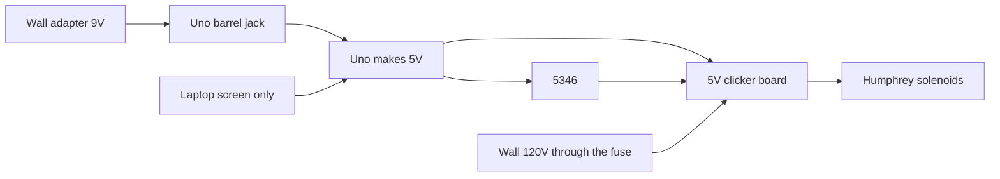
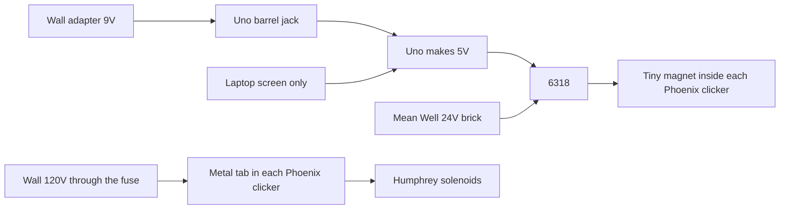

# Maze coils are wall power

All four Maze solenoids are Humphrey coils marked 120 V, 50/60 Hz, 4.5 W, 0–125 psi. That is wall power, so the 6318 stays in the drawer. The ears, the Uno, and the laptop stay. The muscle is the 4-channel relay.

4.5 W on 120 V is 0.0375 A, about 38 mA, on each coil while it is held on. Four held on together are 18 W, about 0.15 A. The 10 A relay contact is far above that. The 1 A slow fuse stays. The 2 A fuse is not needed. US wall power is 60 Hz, and this coil is marked for 50 and 60.

That same 4.5 W, 0–125 psi, 120/50/60 combination is the Humphrey 310/410 family. The catalog lists it as one coil and spring return ([Humphrey solenoid catalog](https://www.alphacontrols.co.uk/wp-content/uploads/pdf/humphrey/solenoid-valves/HKV-9ValveCatalog.pdf)). Air stays at or below 125 psi. No new part comes from that.

## What stays true from the cryo stand

The cryo loop is one valve, commanded by you, with two convection gauges on the screen. Logs are in [development/bench-prep/hornet_plot/data](development/bench-prep/hornet_plot/data). `1100` Torr is an open jack, not a pressure ([logic.py](development/bench-prep/hornet_plot/logic.py)).

- The long Nov 6 file pumps gauge 1 from about 9.15 Torr down to 0.17 Torr, and the closed reed follows the laptop and the button.
- The plot you attached keeps both gauges live in the 0.1 Torr range for about two more hours, with one bump while the gate was already open.
- The sketch does not open a valve because the pressure looks right. Pressure is a picture.

That laptop picture, and the "a pin asks, the valve moves, the reed says whether it shut" idea, are what move to Maze. The 24 V DC Humphrey path does not move with them. That coil is 24 V DC, about 0.28 A, and its diode is for that DC coil only ([08-gate-position.md](development/bench-prep/08-gate-position.md)).

## Why the 6318 is the wrong muscle

The Adafruit 6318 switches eight solenoids from a supply of 3 V to 24 V DC. Each channel is a one-way transistor, 30 V and 3.6 A peak, with a diode across the kick ([Adafruit 6318](https://www.adafruit.com/product/6318)). Wall power sloshes back and forth. A one-way switch cannot do that job. A MOSFET switches DC ([Arduino forum, 24 V AC solenoids](https://forum.arduino.cc/t/24v-ac-solenoid-valves-mosfet/451734)). The diode on that board, and the diode across the cryo coil, would short half of every wall cycle. A diode across an AC coil is the wrong part ([OptoForums](https://forums.opto22.com/t/driving-dc-and-ac-solenoids/5003), [All About Circuits](https://forum.allaboutcircuits.com/threads/benefits-of-driving-ac-solenoid-valve-from-dc.206067)).

The 6318 stays in the drawer for Maze. The single-channel spare, the 5648, is the same kind of DC switch. It stays in the drawer too. No second expander. No second Uno.

## The other shopping list, in plain words

A Humphrey solenoid is the magnet on the valve. It wants wall power, 120 V, the kind that goes back and forth. Four of them together sip about as much as a night-light.

The Arduino cannot touch wall power. A relay is the helper. Inside every relay is a second, tiny magnet. When that tiny magnet gets the right power, it yanks a metal tab shut, and the wall power then flows through that tab to the Humphrey solenoid.

The Phoenix relay's metal tab is strong enough for these solenoids. The tiny magnet inside that Phoenix relay wants 24 V of straight power, and it will not wake up on the Arduino's 5 V ([PLC-RSC-24DC/21](https://www.phoenixcontact.com/en-us/products/relay-module-plc-rsc-24dc21-2966171)). The list buys a 24 V brick and never buys a finger that turns that 24 V on and off for each valve. The 6318 you already own is that finger. It can switch 24 V. It must not be wired to the Humphrey solenoids.

The 24 V brick feeds only the tiny magnet inside each Phoenix relay. It must not feed a Humphrey solenoid. The barrel adapter is just a plug for the brick.

The fuse socket they listed does not come with the fuse, and the maker's page asks for 50 sockets. The fuse itself is still the 1 A one. Each Phoenix relay is 94 mm deep. The small Hammond box is 50 mm deep, so the relays do not fit in it.

The cheaper 4-relay board has tiny magnets that wake up on 5 V. The Arduino can poke those directly. That path does not need the 24 V brick and does not need the 6318.

## The 6318 does not sit in front of the 5 V relay board

The 4-channel relay board is already the driver for four coils. Each IN pin is a small poke, a few milliamps, and the board itself clicks its own 5 V coil. The 5346 has those four pokes. Putting the 6318 between the 5346 and the relay board stacks two drivers on one click.

The 6318 also cannot take the wall-power leads on its solenoid screws. Those screws are 3 V to 24 V DC only ([Adafruit 6318](https://www.adafruit.com/product/6318)). The wall pair lands on the relay's COM and NO screws, and nowhere else.

Leave the 6318 unplugged for Maze. An 8-valve Maze would be an 8-channel relay board of the same kind, still not the 6318.

## Two pictures

The laptop is only the screen. Power for the Uno comes from a wall adapter into the barrel jack. That adapter should be 9 V, about 1 A. The barrel jack is the Uno's front door. The Uno then makes 5 V for itself and for the clicker. A 5 V adapter in that barrel jack is too weak, because the Uno has to drop the incoming voltage down to 5 V.

Our path. The clicker wakes up on 5 V, so the 6318 stays unplugged.

The 9 V adapter feeds the brain. The brain's 5 V wakes the clicker. A separate wall wire, through the fuse, goes into the clicker's metal tab and out to each Humphrey solenoid.

The other path. The Phoenix clicker wakes up on 24 V, so the 24 V brick and the 6318 are both in the picture.

The 24 V comes from the Mean Well brick, which plugs into the wall and puts out straight 24 V. That 24 V enters the 6318. The Uno, still powered by the 9 V barrel adapter, tells the 6318 which of the four tiny magnets to wake. The 6318 hands 24 V to that tiny magnet. The magnet yanks the metal tab shut. Wall power, the other wire, goes through that tab to the Humphrey solenoid. The 24 V brick never touches a Humphrey wire.

The cryo red board is not the Maze board. This project caps that cube at 30 V DC ([08-gate-position.md](development/bench-prep/08-gate-position.md)). Wall power does not land on it.

## Buy these four things

Nothing else. No second Uno, no second switch board, no 6318, no 5648, no diode for these coils.

- **The clicker.** [ShillehTek 4-Channel 5V Relay Module](https://shillehtek.com/blogs/shillehtek-product-manuals/4-channel-5v-relay-module-manual), $7.50 on that page (Feb 11, 2026). Four relays, each printed **SRD-05VDC-SL-C**, contacts **10 A at 250 VAC**, 5 V coil, about 70 mA per click and about 280 mA if all four are on. A LOW on IN1–IN4 is "on." That is the opposite of the cryo board, whose H jumper makes a HIGH the click. The sketch has to match this board. Header is GND, IN1, IN2, IN3, IN4, VCC. Each channel has COM, NO, and NC screws. When the box arrives, read the cube. If it does not say SRD-05VDC-SL-C and 10 A 250 VAC, it is the wrong board. DigiKey does not sell this module.
- **The fuse.** [Littelfuse 0215001.MXP](https://www.digikey.com/en/products/detail/littelfuse-inc/0215001-MXP/777431), DigiKey **F1696-ND**. Ceramic, 5×20 mm, **1 A**, **250 VAC**, slow blow. Four Humphrey coils held on are about 0.15 A, so 1 A is the right size. Buy two, one in the holder and one spare. The 2 A fuse is not the one.
- **The holder.** [Littelfuse 01500274Z](https://www.digikey.com/en/products/detail/littelfuse-inc/01500274Z/29453), DigiKey **F1468-ND**. In-line holder, 10 A, 350 V, made for a 5×20 mm cartridge. The page has shown it around $4 with stock. It sits in the wall feed, inside the box, ahead of the four COM screws.
- **The box.** [Hammond 1591DBK](https://www.hammfg.com/part/1591DBK). Black ABS, 150 × 80 × 50 mm, UL94 V-0, IP54. The relay board is about 75 × 55 × 19 mm, so it fits with the holder beside it. Search DigiKey for that Hammond number. Wall screws stay inside. Breadboard jumpers do not carry the wall pair.

The 5346 still has four spare pokes for those IN pins: A7, B3, B6, and B7. A7 and B7 are already forced to outputs because they are a bad choice as changing inputs ([resources/README.md](development/bench-prep/resources/README.md)). Using them as outputs is the use the sketch already gave them. Position reeds stay on the other 5346 pins, at 5 V, the way A4 works now. Wall power never reaches a reed.

Four valves with one coil each use four contacts. A valve with a separate open coil and close coil uses two contacts. Eight contacts would mean an 8-channel module instead of a 4-channel one. That count waits on the labels.

## What does not get copied from the cryo page

- The 1N400x diode across the Humphrey coil stays on that DC coil. It does not go across a Maze coil.
- 24 V negative staying off Uno ground was the cryo rule. The Maze rule is stronger: the wall pair stays on the relay screws, inside the box, and never shares a screw with the Uno, the 5346, or the Hornet.
- If the 5 V that clicks the relays dies, spring-return valves go home, which is the behavior you already saw on the cryo gate. A valve that needs power to close will not. The label, or a power-off test later, is what settles that. It is the same open item already in [04-valves.md](development/04-valves.md).

Wiring waits until the four labels are read and the boxed relay is the part in front of you. The open bench does not get a 120 V lead.

Sources:

- [Adafruit I2C to 8 Channel Solenoid Driver](https://www.adafruit.com/product/6318)
- [24V AC solenoid valves MOSFET](https://forum.arduino.cc/t/24v-ac-solenoid-valves-mosfet/451734) (Apr 12, 2017)
- [Driving DC and AC solenoids](https://forums.opto22.com/t/driving-dc-and-ac-solenoids/5003) (Jan 12, 2021)
- [Benefits of Driving AC Solenoid Valve from DC](https://forum.allaboutcircuits.com/threads/benefits-of-driving-ac-solenoid-valve-from-dc.206067) (Mar 30, 2025)

- [ShillehTek 4-Channel 5V Relay Manual](https://shillehtek.com/blogs/shillehtek-product-manuals/4-channel-5v-relay-module-manual) (Feb 11, 2026)
- [Littelfuse 0215001.MXP](https://www.digikey.com/en/products/detail/littelfuse-inc/0215001-MXP/777431)
- [Littelfuse 0215002.MXP](https://www.digikey.com/en/products/detail/littelfuse-inc/0215002-MXP/777434)
- [Littelfuse 01500274Z](https://www.digikey.com/en/products/detail/littelfuse-inc/01500274Z/29453)
- [Hammond 1591DBK](https://www.hammfg.com/part/1591DBK)
- [Humphrey solenoid catalog, 310/410, 4.5 W, 0–125 psi, 120/50/60](https://www.alphacontrols.co.uk/wp-content/uploads/pdf/humphrey/solenoid-valves/HKV-9ValveCatalog.pdf) (Sep 10, 2015)
- [Humphrey S310-120VAC](https://www.radwell.com/Buy/HUMPHREY/HUMPHREY/S310-120VAC)

Search notes are in `.cursor/agent-scratch/maze-relay-sku.json`, `.cursor/agent-scratch/maze-us-parts.json`, and `.cursor/agent-scratch/maze-fuse-holder.json`.
