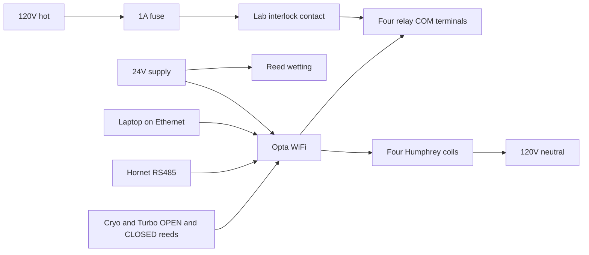

# MAIZE on one Opta WiFi

The replacement rack now has an implemented [LabVIEW project and Opta wiring schedule](../../labview/README.md). It uses the physical Roughing and Let-up selectors for their indications, the four gate contacts for Turbo and Cryo, and one D1608E for the panel inputs and four two-color lamps. The base-only allocation below records the earlier design.

The Maze box becomes one brain: **Arduino Opta WiFi, SKU AFX00002**. The Uno, the 5346, the 6318, and the $7 five-volt relay board stay out of this box. The cryo bench keeps its own 24 V DC Humphrey coil; that coil is a different machine and does not move onto these 120 V contacts.

Official variant table: Lite (AFX00003) has Ethernet only. RS485 (AFX00001) adds half-duplex RS-485 and no radio. WiFi (AFX00002) has Ethernet, half-duplex RS-485, and 2.4 GHz Wi-Fi. All three have the same eight inputs and four relays. Source: [Opta datasheet](https://docs.arduino.cc/resources/datasheets/AFX00001-AFX00002-AFX00003-datasheet.pdf), [Opta user manual](https://docs.arduino.cc/tutorials/opta/user-manual).

## What each screw does

Power. Opta wants 12–24 V DC on its supply screws. At 24 V it draws at most 2.2 W. USB-C programs the board and does not power the relays, so a live coil test with only the USB cable is impossible. Arduino’s manual names the Finder 78.12.1.230.2400 as the 24 V supply, and the getting-started list asks for at least 0.5 A. That 24 V feeds Opta and, later, the reed contacts. It never feeds a Humphrey coil.

Coils. Four normally-open dry contacts, each rated 10 A at 250 V AC. AC15 (solenoid) rating is 500 VA. Each Maze coil is 120 V, 4.5 W, about 38 mA, so four together are about 0.15 A. The existing 1 A slow fuse, Littelfuse 0215001.MXP in holder 01500274Z, sits in the hot wire ahead of all four COM screws. Each NO screw goes to one coil. The other coil lead returns to neutral. No diode across these AC coils. The sheet says the relays have no short-circuit protection of their own.

Reeds. Eight inputs, I1–I8, accept 0–24 V. The sheet calls a level “off” at or below 4.46 V and “on” at or above 6.6 V. That is a higher bar than a Uno pin and a lower bar than a factory input, which waits until 11 V or 15 V. Input resistance is 8.9 kΩ, so a reed wetting from 24 V draws about 2.7 mA. Only the Cryo and Turbo gates carry reeds, one OPEN and one CLOSED on each. The other two valves have no position switches. The LabVIEW commissioning sketch proposes I1–I4 for these four contacts. The old rack photo identifies the two unsensed valves as Roughing and Let-up. Its terminal wiring and relay order still need a field trace. I5–I8 remain available in that allocation. A Maze reed gets 24 V only after its own label allows 24 V and that current. The cryo reed’s 28 V / 20 mA note does not speak for the Maze switches.

Gauge. Opta WiFi’s RS-485 screws are A(−), B(+), and GND, half duplex, no built-in terminator. The port can carry a custom serial stream, which is what the Hornet already speaks. It is not assumed to be Modbus. The sections read do not say this port is galvanically isolated. The bench path uses the DFR0845 because that board is isolated. Hornet pin 4 does not land on Opta GND until that isolation is confirmed from the sheet or a measurement. Until then the gauge reader stays the isolated bench path, and Opta still owns the valves.

Laptop. Ethernet is the link. Wi-Fi exists on this SKU and stays off while MAIZE is charged or fired. A radio in the cell is another antenna, not a shield. The Python window that today sends `o` and `c` down USB does not drive these relays. Valve orders and the pressure picture move to a program on the Opta. USB-C is for loading that program.

## What makes a wrong brain safe

Opta has exactly four relays, and all four are the “on” kind. There is no fifth contact to guarantee every coil drops. Spring-return, which the Humphrey 310/410 catalog states for this 4.5 W coil, goes home when the contact opens or the 24 V supply dies. A valve that needs power to close will not. That power-off test is still open in [development/04-valves.md](development/04-valves.md).

The lab’s existing interlock contact sits in the 120 V hot, ahead of the fuse-to-COM path. Opta cannot hold a coil on while that contact is open. The steel cabinet bonds to Opta’s functional-earth screw. 24 V negative is not 120 V neutral.

A pulse can still shove a few volts onto a wire. Opta will treat 6.6 V as a real press. The program must not copy the Uno bug, where every new press on one screw flipped the coil. The Cryo and Turbo gate positions come from their own reed pairs. The replacement uses the physical selector on each unsensed valve for its indication and waits for its opening output to drop and its verified closing interval to elapse before allowing the opposing path. High-vacuum opening requires qualified chamber pressure. No shot sequence lives in this box.

More than four AC coils, or more than eight inputs, means one Opta Digital Expansion D1608E (AFX00005): 16 inputs and eight mechanical relays at 6 A, 250 V AC, with its own 24 V feed. The solid-state expansion D1608S is 24 V DC only and cannot switch these coils. Do not buy an expansion for the four valves already counted.

## Buy, and do not buy

Buy: Opta WiFi AFX00002, a 24 V supply of at least 0.5 A (Finder 78.12.1.230.2400 or equal), the 1 A fuse and holder already named, a steel DIN cabinet, and the interlock contact in the 120 V feed.

Do not buy: the ShillehTek 5 V board, the Hammond plastic 1591DBK, another Uno, the 6318, the 5648, or a diode for these coils.

Wiring still waits on two reads: each Maze reed’s voltage and current mark, and whether Opta’s RS-485 ground is isolated from the 24 V supply. The open bench does not get a 120 V lead.

When this plan is accepted, replace the buy list and the two drawings in [.cursor/plans/maze_four_valves_d6ab5256.plan.md](.cursor/plans/maze_four_valves_d6ab5256.plan.md). Leave the cryo pages on the Uno.

Sources:
- [Arduino Opta datasheet](https://docs.arduino.cc/resources/datasheets/AFX00001-AFX00002-AFX00003-datasheet.pdf) (modified 13 Nov 2026)
- [Opta user manual](https://docs.arduino.cc/tutorials/opta/user-manual) (22 Sep 2026)
- [Opta hardware page](https://docs.arduino.cc/hardware/opta/)
