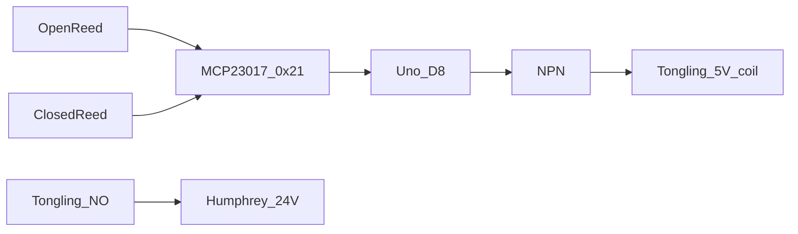

# Phase 3: wire the whole gate circuit, then test in pieces

This plan is superseded. The open switch melted into a short. It is not a sensor, it is not wired, and no sketch reads it. The only gate switch is the closed reed on 5346 A4. Follow [08-gate-position.md](development/bench-prep/08-gate-position.md). The wiring steps below are the old draft.

The supplied sheet is the design basis. It matches the HVA SG installation manual and the Humphrey Tyna-Myte catalog. `062-4E1` and `125-4E1` are the same electrical coil, 24 V DC at 6.7 W, so the relay contact does not care which orifice is fitted. Air is 80 psig maximum. Valves 6 inch ID and smaller lock closed if air is lost; that clause is in the supplied sheet.

## What the manuals actually say

- SG position switches are two-wire, normally open reed switches. Each closes only when the cylinder magnet is next to it. The wires are marked open or closed. Ratings in the installation manual: 3 W, 0.25 A switching, 100 V DC class. The Lesker SG sheet caps the indicator circuit at 28 V DC and 20 mA. A 5 V pull-up is inside both limits. 24 V across a reed is not the Arduino interface. Sources: [HVA / Lesker installation manual](https://www.lesker.com/newweb/valves/pdf/manuals/sg_series_gatevalve_manual.pdf), [Lesker SG data sheet](https://www.lesker.com/newweb/valves/pdf/17-112-va-ds-sgseriesstainlesssteelgatevalve.pdf).
- Air service is 80 psig maximum. Viton-bonnet valves are set up horizontal. Pneumatic valves 6 inch ID and smaller lock over center and stay sealed if air is lost. Pneumatic valves 8 inch ID and larger that shipped with a solenoid do not lock over center. Cryo-Torr 8 is an 8 inch pump; the gate ID is still unread, so air-loss behavior stays unknown until the nameplate is read. Same HVA manual.
- The Humphrey coil in this build is 24 V DC, 6.7 W, about 0.28 A, spring-return 4-way. A Uno pin cannot drive it. Sources: [Humphrey Tyna-Myte catalog](https://www.mrostop.com/uploads/humphrey_pdfs/062E_125E.pdf), [Humphrey electrical table](https://www.mrostop.com/uploads/humphrey_pdfs/T0624E26170CD1205060_datasheet_1.pdf).
- Tongling `JQC-3FF-S-Z` at 5 V: coil 69 ohm, 71.4 mA. That is above a Uno pin. Contacts are form C, 10 A 250 VAC / 15 A 125 VAC, maximum 30 V DC, and one sheet also lists 10 A at 28 V DC. 24 V at 0.28 A is inside that DC window. The contact table is for a resistive load, so the Humphrey coil gets a diode across it. The relay is the isolator for that coil later. It is not in the reed circuit. Sources: [Tongling JQC-3FF-S-Z](https://en.tonglingrelay.com/product/JQC-3FF-S-Z-5VDC-15A-5V-Relay-1065.html), [JQC-3FF-S-Z datasheet](https://www.makerhero.com/img/files/download/JQC-3FF-S-Z-Datasheet.pdf).

A shorted closed reed looks like “valve is closed” all the time, including when the gate is open. That is a false proof. The open reed, if it still opens and closes with the magnet, is a real open proof. Open-switch false means “not proven open.” It does not mean closed. [development/04-valves.md](development/04-valves.md) already requires the two proofs to be independent, and it already forbids treating an I2C driver as a safe close.

## One wiring pass

USB unplugged while the wires go on. Air at or below 80 psig. Do not move the speed-controller screws. D5, D6, and D7 stay empty. A0, A1, A2 stay the lamps. Uno A4 and A5 stay the 5346 data and clock. The 5346's own A4 and B4 are the new reed pins. Hornet and DFR0627 can stay on the bus. 24 V negative does not join Uno ground.

Reed pairs, 5 V only. If a pair already has more than 5 V on it from an old lamp circuit, lift that circuit first, then land the pair.

- Open reed: one wire to 5346 **A4**, the other to logic ground.
- Closed reed: one wire to 5346 **B4**, the other to logic ground. If that pair measures about 0 ohms with the gate open and with the gate shut, it is a stuck short. That pair stays off B4. Everything else still gets wired.

Relay and coil, same pass:

- Uno **D8** through about 1k to the base of a small NPN. Emitter to Uno GND. Collector to one pin of the Tongling 5 V coil. Uno 5V to the other coil pin. Diode across that coil, stripe toward 5 V. The coil is 71.4 mA, so D8 does not drive it directly.
- 24 V positive to the relay contact marked common. The normally open contact to one Humphrey lead. The other Humphrey lead to 24 V negative. Diode across the Humphrey coil, stripe toward the 24 V side. Normally open means the coil is off until D8 is commanded.

Extend [development/bench-prep/firmware/gpio_interlock_bench/gpio_interlock_bench.ino](development/bench-prep/firmware/gpio_interlock_bench/gpio_interlock_bench.ino) in that same pass: print `OPEN` and `CLOSED`, and hold D8 low until a typed command. Both true is a fault. Open true and closed false is open. Open false and closed true is closed. Both false is unknown. Open false is never treated as closed. A2 stays the old simulated closed jumper and is not reused.

## Tests after the wires are in

1. D8 stays low. Look at the gate and the two printed bits.
2. A short D8 command. The relay clicks, the Humphrey coil gets 24 V, the gate moves, the reed bits change, then D8 goes low and the spring returns the pilot.

## What gets written after you confirm

Update [development/bench-prep/06-field-holds.md](development/bench-prep/06-field-holds.md) and [development/bench-prep/pin-map.csv](development/bench-prep/pin-map.csv) for A4 open, B4 closed, and D8 as the relay command. The 6318 is not in this circuit.
