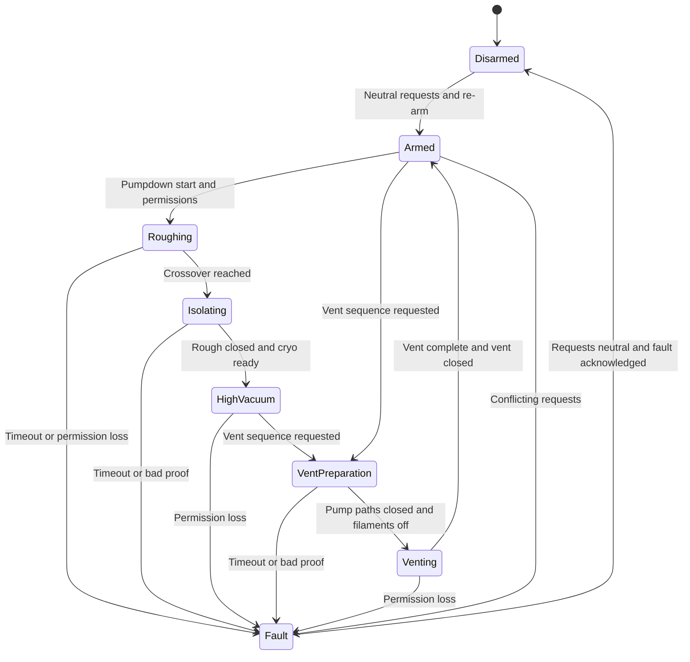

# Controller behavior and future sequence design

Revision 2026-10-09 • Phase 1 code supplied; Phases 2–5 implementation follows their verified interfaces

## Permission rules

| Request | Required conditions |
|---|---|
| Cryo OPEN | Armed; no vent request; vent proven closed; chamber pressure valid/fresh and below reviewed cryo limit; cryopump cold/ready; valve diagnostics healthy |
| Vent OPEN | Armed; no pump opening request; every chamber pump isolation valve physically closed; hot filaments proven OFF; valve diagnostics healthy |
| Rough OPEN | Armed; no vent request; vent proven closed; roughing pump ready; valve diagnostics healthy |
| Turbo OPEN, if installed | Armed; no vent request; vent closed; chamber pressure permission; turbo ready/full speed; backing ready; healthy valve/controller feedback |

Other simultaneous pump openings, shared rough/backing routing and regeneration states must be decided from the actual plumbing. Do not invent a universal rule allowing every combination. The cryopump does not use a turbo-style continuous backing connection.

The Phase 1 simulation implements the cryo/vent subset only. `OTHER PUMP PATHS CLOSED` is one fake flag; the final system uses individual path proofs. `FILAMENT OFF / PROCESS SAFE` is also fake until a verified field status input exists.

## Request, command and position are different

- **Request:** what the operator or sequence wants.
- **Command:** what the interlock currently permits the driver to do.
- **Position:** what the physical sensor reports.

Report all three. Removing OPEN does not prove CLOSED. A maintained switch left ON after a fault must not reopen a gate. Require request release, deliberate re-arm and a fresh request. A pulse-operated actuator needs a command adapter distinct from a maintained-output actuator.

## Control modes

OFF inhibits openings and requests closure through the verified close mechanism. MANUAL accepts panel requests. AUTO accepts sequence requests. Both use the same permission function. CLOSE has priority over OPEN in every mode. Mode changes cancel pending opening requests and sequences; require neutral requests and deliberate re-arm for a new run.

Final controls: MANUAL/OFF/AUTO selector, ARM/RESET, CLOSE/STOP, and sequence START buttons. Determine contact types and electrical interfaces during panel design. Initial Phase 1 needs only its three buttons.

## Fault behavior

On a relevant loss of permission, cancel the sequence, inhibit openings, issue the defined closing commands, and latch a fault. Show the failed input and actual valve positions. If a gate cannot prove closed, do not vent. Pressure/display/laptop communication faults are distinguished: a lost display must not disable local checks; a lost pressure source must invalidate its permission.

Position contradictions, travel timeout, poor actuation pressure, cryo warming, pump readiness loss, processor/output communication loss and brownout each need a recorded response and measured timing. Do not claim that every actuator closes merely because an electrical output goes LOW.

## Pressure limits are configuration, not guesses

The Cryo-Torr family manual gives the Cryo-Torr 8 maximum crossover gas load as **150 Torr·L**. A first upper-bound calculation is `P × V ≤ allowed gas load`, with P in Torr and chamber volume V in liters. This is not a complete opening criterion: use cryopump temperature/readiness, actual gas/process conditions, pump/valve limits and a reviewed margin. Pressure differential across the gate also matters.

Measure chamber and connected volume; obtain the actual operating procedure and cryogenic temperature criterion. The development baseline intentionally does not assign a universal `1e-3 Torr` crossover. Turbo limits, if used later, come from the actual pump/controller/manual and plumbing.

The [configuration record](interfaces/configuration-record.json) contains unset values. It is a planning record, not a runnable controller configuration. Production firmware must refuse to arm with missing or inconsistent limits, rather than interpreting null/zero as permission.

## Phase 5 state machine

This diagram is the intended sequence design, not an implemented feature of the supplied LED sketch. OFF/CLOSE cancels every state, requests the qualified closing action and returns to Disarmed after position checks; a closure failure remains Fault.

### Pumpdown

Close vent and prove it closed → verify roughing readiness → open roughing → monitor pressure and timeout → at reviewed crossover, close roughing and prove closure → verify cryo cold/ready and pressure → open cryo → monitor status continuously. This initial sequence uses cryo, not a speculative turbo configuration.

### Vent

Cancel pump opening requests → turn off hot filaments by the validated control path and verify OFF → close all chamber pump paths → wait for individual CLOSED proofs within their travel limits → open metered vent → stop at the reviewed vent-complete criterion → close vent and prove closure. Never open vent on a timer alone while CLOSED proof is absent.

Use nonblocking state-machine timers, not long `delay()` calls. Continue evaluating CLOSE, faults and sensor freshness in every state. Include maximum roughdown, motion and vent times, but set them only from measured behavior.

## Future firmware structure

`input adapters → normalized snapshot → requests/mode → permission evaluator → sequence state machine → actuator adapters`

One output arbiter combines CLOSE priority, permissions and independent opening enable. USB logging receives a bounded snapshot; printing must not block control. For Uno memory limits, use fixed buffers, bounded parsing and measured timing. Leave an I/O and power budget before selecting expanders. The [field register](interfaces/field-io-register.csv) is the starting point, not a finalized allocation of every Uno pin.
