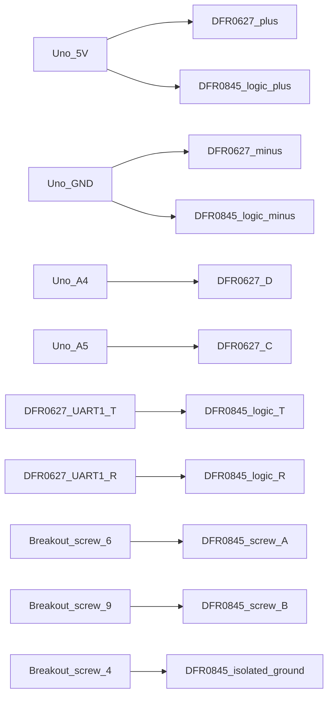

# Hornet read-only trial

This is the only page to follow while wiring the InstruTech IGM402 Hornet
for one read. It does not turn the filament on, does not degas, and does
not connect a valve.

The lamp tests stay where they are. Take the expander, the three lamps,
the buttons, and the jumpers off the desk before this trial. Leave Uno
pins D5, D6, and D7 empty. Do not load the loopback program. That program
shouts practice bytes and must not be aimed at the gauge.

This trial is still not a released gauge harness. Firmware **3351-100** is
not named in the attached book InstruTech **000861-116** (firmware part
**2444**). The pin numbers and the one ASCII sentence below are the
candidate taken from that book after the on-gauge menu matched its factory
speed and address. Record the actual menu, screen, and reply. Do not
store an off flag as a pressure.

Related pages:

- Desk package: [README.md](README.md)
- Already named Uno-side wires R-01 through R-08: [03-connections.md](03-connections.md)
- What is still not a released harness: [06-field-holds.md](06-field-holds.md)
- Test names: [04-tests.md](04-tests.md)
- Pass or fail lines: [verification/physical-test-log.csv](verification/physical-test-log.csv)
- Raw captures: [verification/runs/2026-10-29/hornet-read/](verification/runs/2026-10-29/hornet-read/)

## What you reported

- Gauge: InstruTech IGM402 Hornet hot cathode
- Firmware: 3351-100
- Speed: 19200, 8 data bits, no parity, 1 stop bit
- Address: 1
- The menu can speak ASCII or binary. The book recommends ASCII. The
  first read sentence below is the ASCII sentence. If the highlighted
  choice on the gauge is binary, do not send that sentence. Set the menu
  to ASCII first, or stop and say it is still binary.

## What comes off the desk first

1. Unplug the Uno USB cable.
2. Take the expander, the three lamps, the buttons, and the jumpers off.
3. Leave D5, D6, and D7 empty.
4. Do not upload `uart_loopback`.

## Uno side, eight wires

These are the wires already named R-01 through R-08. The small serial
board is the DFR0627. The RS485 board is the DFR0845. "Logic" means the
side of the DFR0845 next to the little white plug, not the screw side.

| ID | From | To |
| --- | --- | --- |
| R-01 | Uno 5V | DFR0627 `+` |
| R-02 | Uno 5V | DFR0845 logic `+` |
| R-03 | Uno GND | DFR0627 `-` |
| R-04 | Uno GND | DFR0845 logic `-` |
| R-05 | Uno A4 | DFR0627 `D` |
| R-06 | Uno A5 | DFR0627 `C` |
| R-07 | DFR0627 UART1 `T` | DFR0845 logic `T` |
| R-08 | DFR0627 UART1 `R` | DFR0845 logic `R` |

R-07 and R-08 use the same letter on both boards. On 2026-11-02 the
crossed pair left the DFR0845 TX light dark and the gauge silent. The
matched pair kept that light lit for an eight-second shout and returned
a convection reading. Both loop jumpers stay off the DFR0627. DFR0845
12 V screws stay empty.

## How you find pin 6, without cutting a cable

Do not pull wires out of a finished cable. A molded cable hides the pin
numbers. The gauge's RS485 port is the socket with holes, the female
one. The other port on the gauge has pins sticking out. That one is the
analog port. Do not plug the data cable into the port with pins sticking
out.

The part that makes the pin numbers obvious is the Adafruit 3123, already
in the parts pile. It is a small board with a male 9-pin plug on one end
and a row of screws on the other. Nine of those screws are printed 1
through 9. Those numbers are the same numbers as the holes they mate
with. One extra screw is printed GND. That extra screw is the metal
shell around the plug, the shield. It is not Hornet pin 4, and it is not
the ground this trial uses.

1. Plug the 3123's male plug into the gauge's female RS485 socket. The
   D-shape only fits one way. The two housing screws that lock that
   D-shape in the socket are optional if the plug is fully seated. They
   are not pin 4, 6, or 9, and they do not carry the reading.
2. Screw 6 on the 3123 is Hornet pin 6, data A (−).
3. Screw 9 on the 3123 is Hornet pin 9, data B (+).
4. Screw 4 on the 3123 is Hornet pin 4, the ground the gauge's own book
   names for the data pair.
5. Run one loose jumper from each of those three screws to the DFR0845.
   Leave screws 1, 2, 3, 5, 7, 8, and the shell screw marked GND with no
   wire.

If the tiny numbers beside the gauge's own holes are readable, hole 6 is
the same contact as screw 6. Count nothing from the left or the right. A
drawing of a 9-pin plug is often mirrored, and that is how the wrong hole
gets chosen.

## Gauge side, three wires only

The gauge keeps whatever supply is already feeding it. Do not add the
Uno, and do not add the DFR0845 12 V output. On this RS485 plug, pin 2 is
20–28 V power. Leave screw 2 empty. Power on both of the gauge's plugs
can damage it.

| From | To |
| --- | --- |
| 3123 screw 6 | DFR0845 screw marked `A` on the isolated screw side |
| 3123 screw 9 | DFR0845 screw marked `B` on that same side |
| 3123 screw 4 | DFR0845 ground printed with the RS485 pair, the screw beside `A` and `B` |

Do not use the screw printed as the 12V-in ground. That pair is an unused
power input. Do not use the extra 3123 screw printed GND. That one is
only the metal shell.

That isolated ground is a different screw from the logic `-` used in
R-04. Do not join those two grounds.

Leave 3123 screws 1, 3, 5, 7, and 8 empty. Screws 1, 5, and 7 are a
relay. They are not the reading.

## The trial, in order

1. **H01 menu check**, cable still off the data pins. Confirm 19200, 8,
   N, 1, address 1, and FORMAT set to ASCII. Record that here and in the
   test log. If FORMAT is still binary, stop. Do not send the ASCII
   sentence.
2. **H02 wire look.** Connect the three gauge wires with the Uno
   unplugged. Plug the Uno in only after the three wires are on the
   right screws. Record the look. Confirm screw 2 empty, shell GND empty,
   12 V screws empty, and logic `-` not joined to the isolated RS485
   ground.
3. **H03 one read.** Upload only
   [`firmware/hornet_read_trial/hornet_read_trial.ino`](firmware/hornet_read_trial/hornet_read_trial.ino).
   Do not load `uart_loopback`. Address 1, ASCII, from the 2444 book:
   `#01RDCG1` and a carriage return. That asks for convection gauge 1.
   The reply should match the gauge screen, including the unit. If no
   convection gauge is plugged in, the book says the reply is
   `*01_1.01E+03`. That means "no convection gauge," not a chamber
   pressure. Record the screen and the reply.
4. Do not send the command that turns the ion gauge on. A separate read,
   `#01RD`, while the filament is off, is allowed only as a check that
   "off" comes back as `9.90E+09`. That number is an off flag. It must
   not be stored as a pressure and it must not light a permission lamp.
5. **H04 unplug.** Unplug the three data wires. The laptop must show no
   reading. A number that remains is a fail.

If the menu is ASCII, the address is 1, and there is still no reply,
unplug the Uno and swap only Hornet pins 6 and 9. Try the same one read
again. No other pin moves.

Save each capture under
`development/bench-prep/verification/runs/2026-10-29/hornet-read/`. One
file per check: `h01-menu.txt`, `h02-wiring.txt`, `h03-rdcg1.txt`,
`h04-unplug.txt`.

## What this trial does not do

It does not turn on the hot-cathode filament, does not degas, and does
not connect a valve. The ion gauge's useful range in the book is about
1e-9 to 5e-2 Torr. Air at the bench is far above that. A convection
gauge, if one is plugged into the Hornet, is the reading that can be
compared in air. The lamp-board rules stay in the program already tested.
This trial only checks that a real number can arrive, and that a pulled
cable cannot look like a good pressure.
